# Diagrama de modelos

Diagrama entidad-relación del proyecto SGR. **Está generado** por `tools/diagrama_modelos.py` a partir de los modelos que Django tiene registrados (`apps.get_models()`); no se edita a mano. Para regenerarlo:

```bash
python tools/diagrama_modelos.py            # escribe este documento
python tools/diagrama_modelos.py --verificar  # falla si está desactualizado
```

GitHub, GitLab y la mayoría de los editores de Markdown dibujan el bloque `mermaid` de abajo. Todas las entidades propias tienen además `created_at` y `updated_at` (no se dibujan) y `deleted_at`: una fecha en ese campo significa que el registro está **archivado** (borrado lógico). `User` y `Group` son los modelos de autenticación de Django, que los modelos propios enlazan.

Lectura de las líneas: `||` = exactamente uno, `|o` = cero o uno, `o{` = cero o muchos. En cada relación el modelo de la izquierda es el **apuntado** por la clave foránea, y la etiqueta es el nombre del campo.

```mermaid
erDiagram
    Beneficiary {
        int id PK
        datetime deleted_at "archivado"
        string rut UK
        string name
        string phone
        string address
    }
    CommunityOrganization {
        int id PK
        datetime deleted_at "archivado"
        string name
        string legal_address
        int territory_id FK "opcional"
        string territory_text
        int active_members
        date constitution_date
        int registry_number UK
        date registration_date
        int directory_number
        bool verified
    }
    Delegation {
        int id PK
        datetime deleted_at "archivado"
        string name UK
        string status
        string managers
        string scope
        string address
        string commune
        string color
    }
    Item {
        int id PK
        datetime deleted_at "archivado"
        int parent_item_id FK "opcional"
        string name
        string description
        string calculation_type
        bool scores
    }
    Officer {
        int id PK
        datetime deleted_at "archivado"
        string institutional_id UK
        string name
        string status
        int delegation_id FK
        int position_id FK
    }
    OrganizationLeader {
        int id PK
        datetime deleted_at "archivado"
        int organization_id FK
        string role
        string role_detail
        string name
        string rut
        string email
    }
    Position {
        int id PK
        datetime deleted_at "archivado"
        string name
        text description
        date valid_from
        date valid_until
    }
    PositionFunction {
        int id PK
        datetime deleted_at "archivado"
        int position_id FK
        string group
        int order
        text text
    }
    PositionItem {
        int id PK
        datetime deleted_at "archivado"
        int position_id FK
        int item_id FK
        decimal weight
        date valid_from
        date valid_until
        string kind
        decimal max_cap
    }
    Service {
        int id PK
        datetime deleted_at "archivado"
        string name
        string status
    }
    Territory {
        int id PK
        datetime deleted_at "archivado"
        string name
        int delegation_id FK
    }
    Activity {
        int id PK
        datetime deleted_at "archivado"
        date date
        text request_description
        text action_taken
        string contact_name
        string phone
        int beneficiary_id FK "opcional"
        int organization_id FK "opcional"
        string requester_kind
        int organization_leader_id FK "opcional"
        string status
        bool requires_visit
        bool added_to_pipeline
        int commitment_id FK, UK "opcional"
        bool requester_is_delegate
        bool counts_for_score
        string no_score_reason
        int item_id FK
        int service_id FK "opcional"
        int delegation_id FK
        int author_officer_id FK
    }
    Commitment {
        int id PK
        datetime deleted_at "archivado"
        string source
        date request_date
        text description
        string requester
        string requester_type
        int territory_id FK
        date due_date
        string support
        string status
        text notes
        bool physical
        int responsible_officer_id FK
        int delegation_id FK
    }
    Followup {
        int id PK
        datetime deleted_at "archivado"
        int sequence_number
        int management_type_id FK "opcional"
        date date
        string result
        date scheduled_visit_date
        date visit_date
        date report_delivery_date
        date benefit_delivery_date
        int activity_id FK
    }
    ManagementType {
        int id PK
        datetime deleted_at "archivado"
        string name UK
    }
    QuarterChangeRequest {
        int id PK
        datetime deleted_at "archivado"
        int activity_id FK
        int delegation_id FK
        string mode
        date previous_date
        date new_date
        text reason
        string status
        int requested_by_id FK
        int resolved_by_id FK "opcional"
        datetime resolved_at
        text resolution_comment
    }
    Evidence {
        int id PK
        datetime deleted_at "archivado"
        string unique_code UK
        file file_link
        datetime uploaded_at
        string review_status
        text metadata
        int activity_id FK
        int author_officer_id FK
    }
    Validation {
        int id PK
        datetime deleted_at "archivado"
        string decision
        datetime date
        text notes
        string result
        string version
        int evidence_id FK
        int reviewer_officer_id FK "opcional"
    }
    Absence {
        int id PK
        datetime deleted_at "archivado"
        int officer_id FK
        string kind
        date start_date
        date end_date
        string notes
        int registered_by_id FK "opcional"
    }
    Adjustment {
        int id PK
        datetime deleted_at "archivado"
        string kind
        string reason
        decimal percentage_value
        datetime date
        int officer_id FK
        int period_id FK
        int responsible_user_id FK
    }
    Feedback {
        int id PK
        datetime deleted_at "archivado"
        string kind
        date date
        string contact_name
        string contact
        string channel
        int officer_id FK
        text description
        file support
        int period_id FK
        bool effective
        int adjustment_id FK, UK "opcional"
        int registered_by_id FK
    }
    Goal {
        int id PK
        datetime deleted_at "archivado"
        decimal target_value
        string unit
        decimal weight
        int version
        int item_id FK
        int officer_id FK "opcional"
        int position_id FK "opcional"
        int period_id FK
    }
    Indicator {
        int id PK
        datetime deleted_at "archivado"
        decimal progress
        decimal compliance
        decimal weighting
        string status_light
        datetime calculated_at
        int goal_id FK
        int officer_id FK "opcional"
    }
    Period {
        int id PK
        datetime deleted_at "archivado"
        date start_date
        date end_date
        int computable_days
        string status
        decimal collective_threshold
        decimal amber_threshold
        decimal weighted_cap
        string parameters_version
        decimal compliment_value
        decimal complaint_value
        int compliment_limit
    }
    RoleProfile {
        int id PK
        datetime deleted_at "archivado"
        int group_id FK, UK
        string description
        string scope
        string status
    }
    UserProfile {
        int id PK
        datetime deleted_at "archivado"
        int user_id FK, UK
        int officer_id FK, UK "opcional"
        int beneficiary_id FK, UK "opcional"
        string status
        file photo
    }
    UserRoleDelegation {
        int id PK
        datetime deleted_at "archivado"
        int user_id FK
        int role_id FK
        int delegation_id FK "opcional"
    }
    AuditLog {
        int id PK
        datetime deleted_at "archivado"
        string event
        datetime date
        string affected_entity
        int record_id
        text previous_value
        text new_value
        int user_id FK
    }
    Comment {
        int id PK
        datetime deleted_at "archivado"
        string entity
        int record_id
        int delegation_id FK "opcional"
        int author_id FK
        text text
    }
    User {
        int id PK
        datetime last_login
        bool is_superuser
        string username UK
        string first_name
        string last_name
        string email
        bool is_staff
        bool is_active
        datetime date_joined
    }
    Group {
        int id PK
        string name UK
    }

    Activity ||--o{ Evidence : "activity"
    Activity ||--o{ Followup : "activity"
    Activity ||--o{ QuarterChangeRequest : "activity"
    Adjustment |o--o| Feedback : "adjustment"
    Beneficiary |o--o{ Activity : "beneficiary"
    Beneficiary |o--o| UserProfile : "beneficiary"
    Commitment |o--o| Activity : "commitment"
    CommunityOrganization |o--o{ Activity : "organization"
    CommunityOrganization ||--o{ OrganizationLeader : "organization"
    Delegation ||--o{ Activity : "delegation"
    Delegation |o--o{ Comment : "delegation"
    Delegation ||--o{ Commitment : "delegation"
    Delegation ||--o{ Officer : "delegation"
    Delegation ||--o{ QuarterChangeRequest : "delegation"
    Delegation ||--o{ Territory : "delegation"
    Delegation |o--o{ UserRoleDelegation : "delegation"
    Evidence ||--o{ Validation : "evidence"
    Goal ||--o{ Indicator : "goal"
    Group ||--o| RoleProfile : "group"
    Group }o--o{ User : "groups"
    Group ||--o{ UserRoleDelegation : "role"
    Item ||--o{ Activity : "item"
    Item ||--o{ Goal : "item"
    Item |o--o{ Item : "parent_item"
    Item ||--o{ PositionItem : "item"
    ManagementType |o--o{ Followup : "management_type"
    Officer ||--o{ Absence : "officer"
    Officer ||--o{ Activity : "author_officer"
    Officer ||--o{ Adjustment : "officer"
    Officer ||--o{ Commitment : "responsible_officer"
    Officer ||--o{ Evidence : "author_officer"
    Officer ||--o{ Feedback : "officer"
    Officer |o--o{ Goal : "officer"
    Officer |o--o{ Indicator : "officer"
    Officer |o--o| UserProfile : "officer"
    Officer |o--o{ Validation : "reviewer_officer"
    OrganizationLeader |o--o{ Activity : "organization_leader"
    Period ||--o{ Adjustment : "period"
    Period ||--o{ Feedback : "period"
    Period ||--o{ Goal : "period"
    Position |o--o{ Goal : "position"
    Position ||--o{ Officer : "position"
    Position ||--o{ PositionFunction : "position"
    Position ||--o{ PositionItem : "position"
    Service |o--o{ Activity : "service"
    Territory ||--o{ Commitment : "territory"
    Territory |o--o{ CommunityOrganization : "territory"
    User |o--o{ Absence : "registered_by"
    User ||--o{ Adjustment : "responsible_user"
    User ||--o{ AuditLog : "user"
    User ||--o{ Comment : "author"
    User ||--o{ Feedback : "registered_by"
    User ||--o{ QuarterChangeRequest : "requested_by"
    User |o--o{ QuarterChangeRequest : "resolved_by"
    User ||--o| UserProfile : "user"
    User ||--o{ UserRoleDelegation : "user"
```



## Revisión manual de las multiplicidades

La multiplicidad sale del tipo de campo, pero hay reglas que un diagrama no muestra (relaciones excluyentes, valores que deben coincidir entre dos campos, límites). Esta tabla recoge las que se revisaron a mano y lo que aclara cada una; las relaciones que no tienen comentario se leen tal como están dibujadas.

| Relación (campo) | Apunta a | Multiplicidad | Comentario de la revisión |
| --- | --- | --- | --- |
| `Evidence.activity` | `Activity` | muchos → uno (obligatoria) | — |
| `Followup.activity` | `Activity` | muchos → uno (obligatoria) | Hasta tres gestiones por atención, numeradas 1, 2 y 3 (restricción única atención + número). |
| `QuarterChangeRequest.activity` | `Activity` | muchos → uno (obligatoria) | — |
| `Feedback.adjustment` | `Adjustment` | uno → uno (opcional) | El ajuste (bonificación o penalización) lo genera el sistema al registrar la felicitación o el reclamo. |
| `Activity.beneficiary` | `Beneficiary` | muchos → uno (opcional) | Una atención es de una persona (beneficiario) o de una organización: al menos una de las dos. |
| `UserProfile.beneficiary` | `Beneficiary` | uno → uno (opcional) | Solo cuentas del perfil Cliente. Un perfil es de un funcionario o de un beneficiario, nunca de ambos. |
| `Activity.commitment` | `Commitment` | uno → uno (opcional) | Una atención puede originar un compromiso de la agenda; cada compromiso nace de, como máximo, una atención. |
| `Activity.organization` | `CommunityOrganization` | muchos → uno (opcional) | Ver Activity.beneficiary: persona u organización, no es obligatorio tener ambas. |
| `OrganizationLeader.organization` | `CommunityOrganization` | muchos → uno (obligatoria) | — |
| `Activity.delegation` | `Delegation` | muchos → uno (obligatoria) | Debe ser la misma delegación del funcionario autor (validación del modelo); se guarda para filtrar rápido. |
| `Comment.delegation` | `Delegation` | muchos → uno (opcional) | — |
| `Commitment.delegation` | `Delegation` | muchos → uno (obligatoria) | — |
| `Officer.delegation` | `Delegation` | muchos → uno (obligatoria) | Define el ámbito (organización A o B) que ve el funcionario y su cuenta. |
| `QuarterChangeRequest.delegation` | `Delegation` | muchos → uno (obligatoria) | — |
| `Territory.delegation` | `Delegation` | muchos → uno (obligatoria) | El nombre del territorio es único dentro de cada delegación (restricción única nombre + delegación). |
| `UserRoleDelegation.delegation` | `Delegation` | muchos → uno (opcional) | Delegaciones adicionales en las que una cuenta ejerce un rol; sin delegación vale para todas. |
| `Validation.evidence` | `Evidence` | muchos → uno (obligatoria) | Una evidencia puede revisarse varias veces; la decisión de cada revisión (aprobada, observada o rechazada) actualiza su estado de revisión. |
| `Indicator.goal` | `Goal` | muchos → uno (obligatoria) | — |
| `RoleProfile.group` | `Group` | uno → uno (obligatoria) | Ficha del rol (descripción y alcance) para cada grupo de Django. |
| `User.groups` | `Group` | muchos ↔ muchos | — |
| `UserRoleDelegation.role` | `Group` | muchos → uno (obligatoria) | — |
| `Activity.item` | `Item` | muchos → uno (obligatoria) | — |
| `Goal.item` | `Item` | muchos → uno (obligatoria) | — |
| `Item.parent_item` | `Item` | muchos → uno (opcional) | Relación consigo mismo: tipo de atención (padre) y sub-atención (hijo). Solo hay dos niveles. |
| `PositionItem.item` | `Item` | muchos → uno (obligatoria) | Ver PositionItem.position. |
| `Followup.management_type` | `ManagementType` | muchos → uno (opcional) | — |
| `Absence.officer` | `Officer` | muchos → uno (obligatoria) | — |
| `Activity.author_officer` | `Officer` | muchos → uno (obligatoria) | — |
| `Adjustment.officer` | `Officer` | muchos → uno (obligatoria) | — |
| `Commitment.responsible_officer` | `Officer` | muchos → uno (obligatoria) | — |
| `Evidence.author_officer` | `Officer` | muchos → uno (obligatoria) | Es quien sube el archivo; normalmente el mismo funcionario que registró la atención. |
| `Feedback.officer` | `Officer` | muchos → uno (obligatoria) | — |
| `Goal.officer` | `Officer` | muchos → uno (opcional) | Una meta es personal (funcionario) o del cargo (position): una u otra, no ambas. |
| `Indicator.officer` | `Officer` | muchos → uno (opcional) | El indicador se guarda por meta y por funcionario; cada recálculo que cambia el valor agrega uno nuevo. |
| `UserProfile.officer` | `Officer` | uno → uno (opcional) | Cuentas de personal: un funcionario, una cuenta. Vacío en cuentas técnicas y de clientes. |
| `Validation.reviewer_officer` | `Officer` | muchos → uno (opcional) | Opcional: queda vacío si el revisor ya no existe como funcionario. |
| `Activity.organization_leader` | `OrganizationLeader` | muchos → uno (opcional) | — |
| `Adjustment.period` | `Period` | muchos → uno (obligatoria) | — |
| `Feedback.period` | `Period` | muchos → uno (obligatoria) | Se deduce de la fecha del registro; un período cerrado ya no admite cambios. |
| `Goal.period` | `Period` | muchos → uno (obligatoria) | — |
| `Goal.position` | `Position` | muchos → uno (opcional) | Ver Goal.officer: meta del cargo, la reciben todos los funcionarios activos de ese cargo. |
| `Officer.position` | `Position` | muchos → uno (obligatoria) | — |
| `PositionFunction.position` | `Position` | muchos → uno (obligatoria) | — |
| `PositionItem.position` | `Position` | muchos → uno (obligatoria) | PositionItem es la tabla intermedia (con ponderación y vigencia) entre Position e Item: relación muchos a muchos. |
| `Activity.service` | `Service` | muchos → uno (opcional) | — |
| `Commitment.territory` | `Territory` | muchos → uno (obligatoria) | El territorio debe pertenecer a la misma delegación del compromiso (validación del modelo). |
| `CommunityOrganization.territory` | `Territory` | muchos → uno (opcional) | — |
| `Absence.registered_by` | `User` | muchos → uno (opcional) | — |
| `Adjustment.responsible_user` | `User` | muchos → uno (obligatoria) | — |
| `AuditLog.user` | `User` | muchos → uno (obligatoria) | Quién hizo el cambio; el registro de auditoría no se borra ni se archiva. |
| `Comment.author` | `User` | muchos → uno (obligatoria) | — |
| `Feedback.registered_by` | `User` | muchos → uno (obligatoria) | — |
| `QuarterChangeRequest.requested_by` | `User` | muchos → uno (obligatoria) | — |
| `QuarterChangeRequest.resolved_by` | `User` | muchos → uno (opcional) | — |
| `UserProfile.user` | `User` | uno → uno (obligatoria) | Cada cuenta tiene un perfil; el perfil enlaza la cuenta con su funcionario o con su beneficiario. |
| `UserRoleDelegation.user` | `User` | muchos → uno (obligatoria) | Una cuenta puede ejercer el mismo rol en varias delegaciones (restricción única usuario + rol + delegación). |
